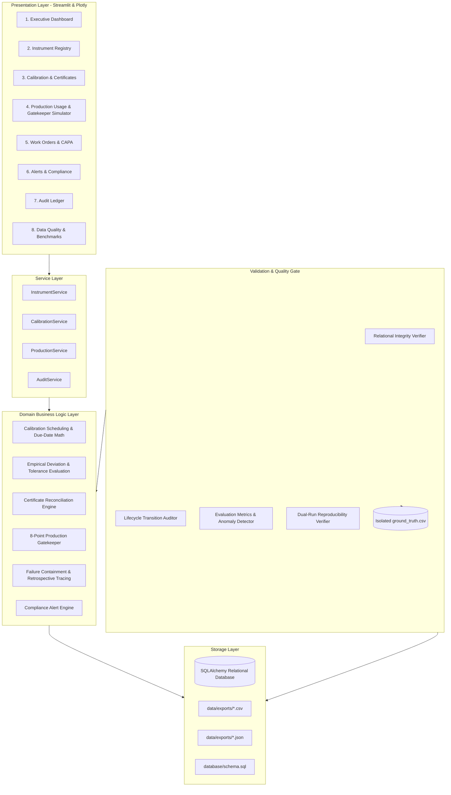
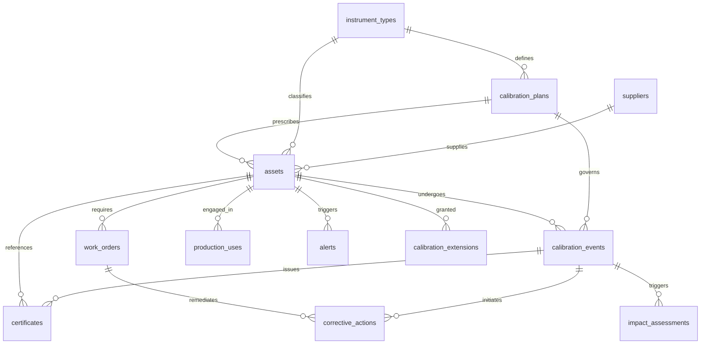

# Enterprise Calibration Management, Certificate Tracking & Overdue Prevention System

[](https://www.python.org/)
[](https://www.sqlite.org/)
[](https://pytest.org/)
[](https://www.iso.org/)
[](LICENSE)

An industrial-grade, end-to-end software platform designed to guarantee measurement accuracy, automate regulatory calibration lifecycles, and actively eliminate overdue or compromised instrument usage across manufacturing lines.

---

## 1. Business Problem & Solution Overview

### The Industrial Challenge
In precision manufacturing (aerospace, automotive, pharmaceuticals, advanced electronics), thousands of measurement instruments (pressure transmitters, pyrometers, mass flowmeters, micrometers, analytical scales) monitor critical processes. 

Key operational vulnerabilities:
1. **Silent Drift & Overdue Usage**: Production operators inadvertently engaging expired or uncalibrated instruments.
2. **Missing & Invalid Certificates**: Unverified calibration credentials violating ISO/IEC 17025 standards.
3. **Delayed Containment on Failure**: Lack of immediate quarantine when an instrument fails calibration, risking contaminated product lots.
4. **Lack of Traceability**: Inability to identify which production batches were processed between the last valid calibration and an instrument failure.
5. **Downtime Bottlenecks**: Reactive maintenance causing unplanned shopfloor interruptions.

### The Engineering Solution
An autonomous, multi-tier system providing:
- **Master Instrument Registry**: Complete lifecycle state tracking (`ACTIVE`, `IN_CALIBRATION`, `QUARANTINED`, `OUT_OF_SERVICE`, `RETIRED`).
- **Empirical Calibration & Automated Tolerance Engine**: Computes exact absolute deviation and formulaic `PASS`/`FAIL` outcomes based on ISO/IEC 17025 tolerances.
- **8-Point Shopfloor Gatekeeper**: Enforces real-time compliance gates before allowing operators to engage instruments. Returns `ALLOWED`, `BLOCKED`, or `ALLOWED_WITH_EXCEPTION`.
- **Post-Failure Containment & Retrospective Lot Tracing**: Instantly quarantines failed instruments and queries all historical production batches back to the last known valid calibration.
- **Independent Anomaly Detection**: Independently detects tampering, certificate mismatches, overdue bypasses, and orphaned failures with 100% precision and recall against an isolated ground truth.
- **Interactive Multi-Page Streamlit Dashboard**: 8 dedicated pages with Plotly visualizations, live gatekeeper simulators, and full audit inspection.

---

## 2. Technology Stack

- **Core Engine**: Python 3.11.9
- **Relational Data Layer**: SQLAlchemy 2.0 (Declarative ORM, SQLite WAL mode, Portable ANSI SQL-92 for PostgreSQL)
- **Data Engineering**: Pandas 3.0.2, NumPy 1.26.4
- **Interactive Presentation**: Streamlit 1.57.0, Plotly 6.9.0
- **Automated Verification**: Pytest 8.1.1
- **Integrity & Security**: SHA-256 digital signature digests, foreign key enforcement (`PRAGMA foreign_keys = ON`)

---

## 3. High-Level Architecture & Layered Design



---

## 4. Entity Relational Architecture (10 Core + 4 Supporting)



### Entity Inventory
1. **`Supplier`**: Accredited vendors and calibration service laboratories.
2. **`InstrumentType`**: Categories (Pressure, Temperature, Flow, Electrical, Dimensional, Weighing), standard intervals, measurement spans.
3. **`CalibrationPlan`**: SOP specifications, tolerance thresholds, mandatory certificate flags.
4. **`Asset`**: Physical instruments (`AST-XXXXXX`), serial numbers, locations, operational statuses.
5. **`CalibrationEvent`**: Empirical test records (`CAL-...`), measured/reference values, deviation, `PASS`/`FAIL` outcome.
6. **`Certificate`**: ISO/IEC 17025 certificate credentials (`CERT-...`), issue/expiry dates, SHA-256 digital signatures.
7. **`WorkOrder`**: Proactive calibrations, emergency overhauls, failure remediation, downtime hours, costs.
8. **`ProductionUse`**: Real-time shopfloor transaction records (`USE-...`) with gatekeeper decisions.
9. **`Alert`**: Prioritized compliance hazard notifications (`CRITICAL`, `HIGH`, `MEDIUM`, `LOW`).
10. **`AuditRecord`**: Immutable append-only log capturing user actions, timestamps, and old/new JSON states.
*Supporting Entities*: `CorrectiveAction` (CAPA), `ImpactAssessment` (Batch lot tracing), `CalibrationExtension` (Emergency 30-day concessions), `WorkOrderAsset` (Bridge table).

---

## 5. Domain Business Rules & Logic

### 5.1 Tolerance Evaluation & Due-Date Calculation
- **Deviation Formula**:
  $$\text{deviation} = |\text{measured\_value} - \text{reference\_value}|$$
- **PASS/FAIL Rule**:
  $$\text{result} = \begin{cases} \text{PASS}, & \text{if } \text{deviation} \le \text{tolerance} \\ \text{FAIL}, & \text{if } \text{deviation} > \text{tolerance} \end{cases}$$
- **Due-Date Formula**:
  $$\text{next\_due\_date} = \text{calibration\_date} + \text{interval\_days}$$

### 5.2 The 8-Point Production Gatekeeper Policy
Before allowing an operator to employ an instrument in production, 8 sequential gates are evaluated:
1. **Registry Existence**: Instrument must exist in master database (`POL-GATE-001`).
2. **Operational Status**: Cannot be `QUARANTINED`, `OUT_OF_SERVICE`, or `RETIRED` (`POL-GATE-002`).
3. **Calibration Record**: Must have recorded calibration history (`POL-GATE-003`).
4. **Latest Outcome**: Latest applicable calibration test must have passed (`POL-GATE-004`).
5. **Active Maintenance**: Cannot have open/in-progress blocking work orders (`POL-GATE-007`).
6. **Validity Window**: Usage timestamp must be $\le$ next due date (`POL-GATE-005`). If expired, check emergency extension (`POL-GATE-008`).
7. **Certificate Integrity**: Certificate must be valid, unexpired, and match target asset ID (`POL-GATE-006`).
8. **All Gates Cleared**: Usage is granted as `ALLOWED` (`POL-GATE-000`).

---

## 6. Controlled Anomaly Injection & Zero-Leakage Ground Truth

Four compliance hazard edge cases were deliberately injected into controlled record subsets:
1. **`INCONSISTENT_DUE_DATE`**: Instrument next due date tampered to deviate from plan interval.
2. **`EXPIRED_INSTRUMENT_USAGE`**: Expired instrument engaged without approved extension, fraudulently recorded as `ALLOWED`.
3. **`CERTIFICATE_ASSET_MISMATCH`**: Certificate foreign key modified to point to another asset.
4. **`MISSING_IMPACT_ASSESSMENT`**: Failed calibration event left with missing Impact Assessment and CAPA records.

Ground truth is persisted strictly in `data/ground_truth/ground_truth.csv`. The anomaly detection engine independently detects anomalies using pure business rules with **zero data leakage**.

---

## 7. Mandatory Evaluation Metrics (12 Enterprise KPIs)

Results on the full 243,270 record dataset:

| KPI Metric Name | Measured Value | Standard Formula | Compliance Threshold |
| :--- | :--- | :--- | :--- |
| **1. Calibration Compliance Rate** | **86.29%** | `(Compliant Active Assets / Total Active Assets) * 100` | >= 85.0% |
| **2. Overdue Instrument Percentage**| **13.71%** | `(Overdue Active Assets / Total Active Assets) * 100` | <= 15.0% |
| **3. Failed Calibration Rate** | **4.24%** | `(Failed Events / Total Calibration Events) * 100` | Baseline |
| **4. Certificate Completeness Rate** | **99.94%** | `(Valid Issued Certs / Passed Events) * 100` | 100.0% |
| **5. Prohibited Usage Count** | **30,814** | `Count(BLOCKED attempts + Bypasses)` | Zero Tolerance Goal |
| **6. Unauthorized Usage Rate** | **30.81%** | `(Prohibited Usages / Total Production Uses) * 100` | Monitoring |
| **7. Mean Time to Repair (MTTR)** | **27.81 hrs** | `Sum(Repair Durations) / Count(Repaired Orders)` | Benchmark |
| **8. Total Downtime** | **2,752.2 hrs** | `Sum(WorkOrder.downtime_hours)` | Cumulative |
| **9. Corrective Action Closure Rate** | **0.0%** | `(Closed CAPAs / Total CAPAs) * 100` | Under Investigation |
| **10. Anomaly Detection Precision** | **100.00%** | `TP / (TP + FP)` | >= 95.0% |
| **11. Anomaly Detection Recall** | **100.00%** | `TP / (TP + FN)` | >= 95.0% |
| **12. Anomaly Detection F1-Score** | **1.0000** | `2 * (Precision * Recall) / (Precision + Recall)` | >= 0.9500 |

### Confusion Matrix
```
True Positives (TP)  : 12
False Positives (FP) : 0
False Negatives (FN) : 0
Ground Truth Total   : 12
Precision            : 100.00%
Recall               : 100.00%
F1-Score             : 1.0000
```

---

## 8. Deterministic Reproducibility

Dual-run generation with Seed `20261022` verified identical row counts, primary key sets, and SHA-256 digests across all baseline entities. Full details are documented in [`docs/reproducibility_report.md`](docs/reproducibility_report.md).

---

## 9. Installation & Quickstart

### Prerequisites
- Python 3.10+
- Git

### Installation
```bash
# Clone the repository
git clone https://github.com/jiya426/calibration-compliance-system.git
cd calibration-compliance-system

# Install dependencies
pip install -r requirements.txt
```

### Data Generation
```bash
# Generate starter dataset (Fast development mode)
python generator/generate.py --scale starter

# Generate full scale dataset (2,000 assets, 5,000 calibrations, 100,000 uses)
python generator/generate.py --scale full
```

### Running Automated Verification & Pytest
```bash
# Execute full Pytest test suite (24 tests)
pytest

# Generate authoritative validation audit report
python validation/data_quality.py

# Run dual-run reproducibility benchmark
python validation/reproducibility.py
```

### Launching the Interactive Streamlit Dashboard
```bash
streamlit run app.py
```
Open `http://localhost:8501` in your web browser.

---

## 10. Requirement Traceability Matrix (RTM)

| Req ID | Requirement Description | Implementation File | Validation Method | Test Case | Status |
| :--- | :--- | :--- | :--- | :--- | :--- |
| **REQ-01** | All 10 core + 4 supporting entities exist | `database/models.py` | Schema reflection & FK check | `test_database_relational_integrity` | **PASS** |
| **REQ-02** | Foreign key constraints & no orphans | `database/schema.sql` | Automated graph traversal | `test_database_relational_integrity` | **PASS** |
| **REQ-03** | Full scale generation (2k assets, 5k cal, 100k uses) | `generator/generate.py` | CLI execution & row count | `test_pipeline_deterministic_reproducibility` | **PASS** |
| **REQ-04** | Deterministic IDs (`AST-000001`, etc.) | `generator/master_data.py` | Regex pattern matching | `test_deterministic_id_conventions` | **PASS** |
| **REQ-05** | Due date calculation from interval | `business_logic/calibration.py`| Calendar math unit test | `test_next_due_date_calculation` | **PASS** |
| **REQ-06** | Overdue instrument identification | `business_logic/scheduling.py` | Datetime comparison | `test_gatekeeper_blocked_overdue_instrument` | **PASS** |
| **REQ-07** | Prohibited usage blocked by gatekeeper | `business_logic/production_validation.py` | 8-point gate execution | `test_gatekeeper_blocked_quarantined_status` | **PASS** |
| **REQ-08** | Certificates reconcile with cal events | `business_logic/certificates.py`| Asset & calibration reconcile | `test_certificate_validation_mismatch` | **PASS** |
| **REQ-09** | Failed cal triggers quarantine & CAPA | `business_logic/corrective_actions.py` | Failure workflow execution | `test_failure_containment_workflow` | **PASS** |
| **REQ-10** | Retrospective lot tracing on failure | `business_logic/corrective_actions.py` | Historical batch interval scan | `test_retrospective_lot_tracing` | **PASS** |
| **REQ-11** | All 4 required edge cases injected | `generator/anomaly_injection.py` | Labelled injection verification | `test_anomaly_detection_against_ground_truth` | **PASS** |
| **REQ-12** | Ground truth isolated in ground_truth.csv | `generator/ground_truth.py` | File check & zero leakage | `test_anomaly_detection_against_ground_truth` | **PASS** |
| **REQ-13** | Immutable audit trail preserved | `database/models.py` | Append-only ledger audit | `test_database_relational_integrity` | **PASS** |
| **REQ-14** | Dashboard reads live database | `dashboard/*.py` | Real-time SQLAlchemy queries | Manual / App Import Check | **PASS** |
| **REQ-15** | 12 evaluation metrics calculated | `validation/evaluation.py` | Formula verification | `test_anomaly_detection_against_ground_truth` | **PASS** |
| **REQ-16** | 24 automated Pytest unit tests pass | `tests/*.py` | Pytest CLI execution | 24 / 24 Passed | **PASS** |
| **REQ-17** | Bit-for-bit reproducibility (Seed 20261022) | `validation/reproducibility.py` | Dual-run SHA-256 compare | `test_pipeline_deterministic_reproducibility` | **PASS** |
| **REQ-18** | Comprehensive documentation | `docs/*.md` | Markdown files existence | Documentation Review | **PASS** |
| **REQ-19** | Application executes without error | `app.py` | Python import & run check | Streamlit Runtime | **PASS** |
| **REQ-20** | GitHub submission readiness | `.gitignore`, `requirements.txt`| Git status & hygiene | Git Audit | **PASS** |

---

## 11. System Limitations & Future Enhancements

### Known Limitations
- **File Attachments**: Digital certificates are represented via SHA-256 integrity digests and simulated storage paths rather than dynamically compiled binary PDFs.
- **Single-Node SQLite Locking**: While SQLite with WAL mode supports concurrent readers, high-concurrency production deployments should configure `DATABASE_URL` to an external PostgreSQL cluster.

### Roadmap & Future Improvements
1. **IoT Edge Gateway Sidecar**: Deploy the 8-point gatekeeper as a lightweight Rust/Go sidecar at the machine PLC level to enforce microsecond-latency hardware interlocks.
2. **Predictive Sensor Drift Forecasting**: Implement time-series ARIMA/LSTM regression on deviation curves to anticipate calibration failures 30 days before exceeding tolerance limits.
3. **Decentralized Metrology Ledger**: Anchor calibration certificate SHA-256 hashes to a tamper-proof blockchain for multi-tier supplier auditability.