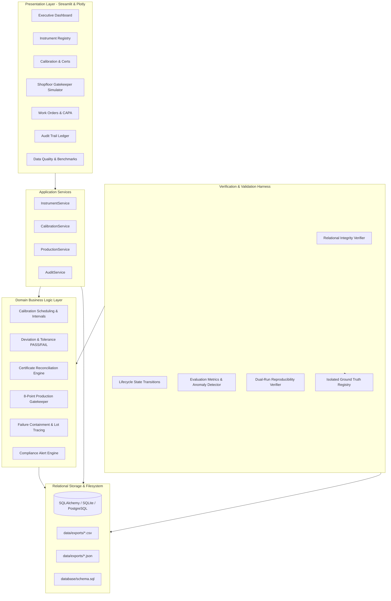
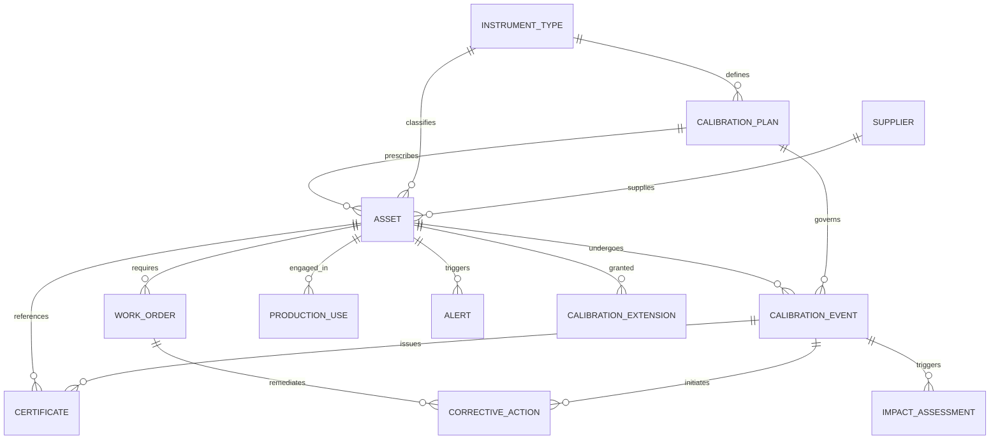

# System Architecture: Enterprise Calibration & Compliance System

## 1. Architectural Overview & Design Principles

The Enterprise Calibration & Compliance System is an end-to-end, multi-tier industrial software platform designed to guarantee measurement accuracy, enforce regulatory compliance (ISO/IEC 17025, FDA 21 CFR Part 11, IATF 16949), and proactively eliminate overdue instrument usage across manufacturing lines.

### Core Architectural Principles:
1. **Separation of Concerns**: Strict decoupling of Storage, Domain Business Logic, Application Services, Data Generation, Presentation, and Validation.
2. **Deterministic Reproducibility**: All random master and transaction generators utilize explicit random seeds (`20261022`) guaranteeing bit-for-bit reproducible baseline records.
3. **Immutability & Audit Trail**: Operational records, calibrations, and certificates are append-only. State changes are captured as explicit audit records with JSON snapshots of old and new states.
4. **Zero-Data-Leakage Validation**: The anomaly detection engine operates strictly on raw database relations using pure business heuristics. Isolated ground truth (`data/ground_truth/ground_truth.csv`) is preserved solely for post-hoc precision/recall evaluation.
5. **Portability**: Schema adheres to ANSI SQL-92 standards and SQLAlchemy 2.0 ORM, enabling seamless switching between local SQLite (with enforced `PRAGMA foreign_keys = ON`) and enterprise PostgreSQL.

---

## 2. Layered Architecture Diagram

---

## 3. Entity Relational Architecture (Core & Supporting Entities)

---

## 4. Multi-Tier Module Breakdown

### 4.1 Storage & Relational Layer (`database/`)
- `connection.py`: Manages thread-safe session factories, connection pools, and SQLite WAL pragmas with foreign key cascade/restrict guarantees.
- `models.py`: Declarative ORM models for all 10 required core entities (`Supplier`, `InstrumentType`, `CalibrationPlan`, `Asset`, `CalibrationEvent`, `Certificate`, `WorkOrder`, `ProductionUse`, `Alert`, `AuditRecord`) and 4 supporting entities (`CorrectiveAction`, `ImpactAssessment`, `CalibrationExtension`, `WorkOrderAsset`).
- `schema.sql`: ANSI-compliant DDL with explicit primary keys, foreign keys, unique constraints, and optimized B-tree indexes.

### 4.2 Domain Business Logic Layer (`business_logic/`)
- `calibration.py`: Deterministic calculation of absolute deviation `|measured - reference|` and tolerance check `deviation <= tolerance ? PASS : FAIL`. Calculates next scheduled due dates.
- `scheduling.py`: Real-time calendar interval additions, overdue status checking, and emergency extension reconciliations.
- `production_validation.py`: The Shopfloor Gatekeeper. Enforces the 8 mandatory compliance checks before instrument usage is allowed.
- `certificates.py`: Cross-reconciliation between certificates, calibration events, and assets. Identifies mismatches, missing certs, and expired credentials.
- `corrective_actions.py`: Retrospective production batch tracing (identifies all lots produced between last known valid calibration and failure timestamp).
- `work_orders.py`: Maintenance order lifecycle dispatching and Mean Time to Repair (MTTR) analytics.
- `alerts.py`: Standardized alert generation across 8 compliance hazards.

### 4.3 Application Services Layer (`services/`)
- Clean interface between the presentation layer and database, encapsulating transactions, validation, and audit recording.

### 4.4 Presentation Layer (`dashboard/`)
- High-performance Streamlit 1.57 dashboard with Plotly 6.9 interactive visualizations, real-time KPI scorecards, multi-criteria filtering, and live gatekeeper simulator.

### 4.5 Data Quality & Validation Layer (`validation/`)
- Independent verification suite executing relational integrity checks, state transition audits, bit-for-bit reproducibility comparisons, and zero-leakage anomaly detection benchmarks.