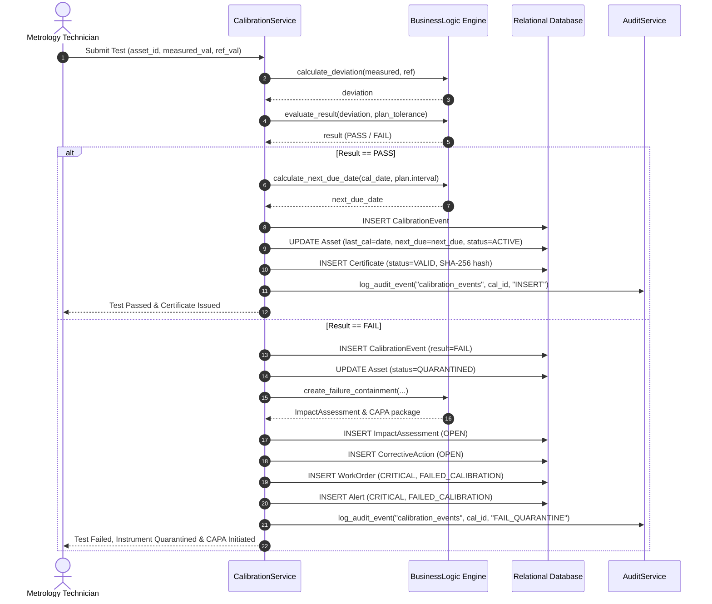
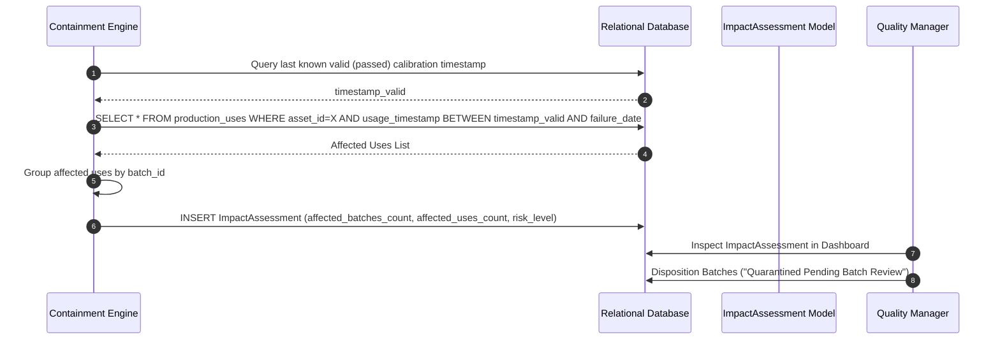
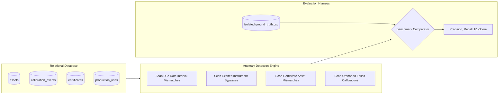

# Data Flow Specification: Enterprise Calibration & Compliance System

## 1. Primary Data Flows & Lifecycle Sequences

### Data Flow 1: Empirical Calibration Test Execution & Certificate Issuance



---

### Data Flow 2: Real-Time Shopfloor Usage Gatekeeper Validation

```mermaid
sequenceDiagram
    autonumber
    actor Op as Plant Operator
    participant PS as ProductionService
    participant Gate as Gatekeeper Engine (8 Gates)
    participant DB as Relational Database
    participant Alt as Alert Engine

    Op->>PS: Request Instrument Usage (asset_id, batch_id, line_id)
    PS->>DB: Fetch Asset, Latest Calibration, Certificate, Active WOs, Extensions
    DB-->>PS: Records
    PS->>Gate: evaluate_production_usage(...)
    Gate-->>PS: Decision (ALLOWED / BLOCKED / ALLOWED_WITH_EXCEPTION)

    PS->>DB: INSERT ProductionUse (usage_id, decision, policy_code, reason)
    
    alt Decision == BLOCKED
        PS->>Alt: Trigger Alert (UNAUTHORIZED_USAGE, CRITICAL)
        Alt->>DB: INSERT Alert
        PS-->>Op: 🛑 Usage Prohibited (Action Blocked)
    else Decision == ALLOWED_WITH_EXCEPTION
        PS-->>Op: ⚠️ Usage Allowed under Emergency Extension
    else Decision == ALLOWED
        PS-->>Op: ✅ Usage Authorized (Gate Passed)
    end
```

---

### Data Flow 3: Post-Failure Retrospective Lot Tracing Flow



---

### Data Flow 4: Zero-Data-Leakage Anomaly Detection Pipeline

